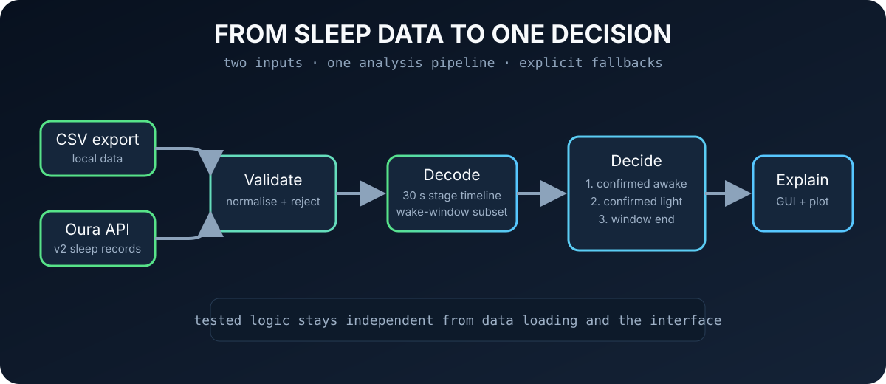

# ŌURA Smart Alarm Analyser

[](https://www.python.org/)
[](LICENSE)

A Python experiment that asks a useful question: **if my ring already knows my sleep stage every 30 seconds, when inside a wake window should the alarm fire?**

It decodes Oura sleep-stage data, rejects brief classification spikes and chooses the earliest confirmed awake or light-sleep moment. If neither appears, it falls back to the end of the wake window.



## Why I built it

I care about sleep and human performance, but I did not want to build another wellness dashboard. I wanted a decision system with a clear output and edge cases that could be tested.

The original idea was a live smart alarm. Investigation showed that Oura's public sleep endpoint does not guarantee a continuous real-time stream during the night, so the honest current version is a post-sync analyser. The limitation changed the product claim, not the quality of the engineering.

## What it does

- Decodes `sleep_phase_30_sec` into a timestamped stage timeline.
- Loads records from an exported CSV or the Oura API v2.
- Confirms sustained awake or light-sleep runs instead of reacting to one noisy sample.
- Gives awake priority, then light sleep, then a forced end-of-window fallback.
- Displays the decision, stage distribution and wake-window chart in a Tkinter GUI.
- Handles duplicate dates, missing files, unavailable records and invalid tokens.
- Keeps the decision logic separate from loading, formatting, plotting and interface code.

## Alarm logic

```text
wake-window samples
        |
        v
5+ consecutive awake? ---- yes ---> trigger awake
        |
        no
        v
5+ consecutive light? ---- yes ---> trigger light
        |
        no
        v
trigger at window end
```

The thresholds are centralised in `config.py`, so the behaviour is explicit and easy to test.

## Quick start

```bash
git clone https://github.com/viggsss/oura-smart-alarm.git
cd oura-smart-alarm

python -m venv .venv
source .venv/bin/activate
pip install -e .

oura-smart-alarm
```

On Windows, activate the environment with `.venv\Scripts\activate`.

### Data sources

For CSV mode, place a semicolon-separated Oura sleep export at `data/sleepmodel.csv`.

For API mode:

```bash
export OURA_ACCESS_TOKEN="your_token_here"
oura-smart-alarm
```

Tokens and local sleep data are ignored by Git. Do not commit either.

## Tests

```bash
pip install -e ".[dev]"
pytest -q
```

The test suite covers timeline decoding, confirmed-run detection, priority behaviour, noisy spikes, empty windows and both forced-fallback paths.

## Structure

```text
src/oura_alarm/
├── analysis.py      # stage decoding and wake decision
├── data_loader.py   # CSV and Oura API paths
├── models.py        # typed analysis results
├── formatting.py    # readable decision summaries
├── plotting.py      # wake-window visualisation
├── gui.py           # Tkinter interface
└── config.py        # thresholds and defaults
```

## What I would build next

- Timezone-aware parsing end to end.
- Configurable confirmation thresholds in the GUI.
- Historical analysis across multiple nights.
- A real notification or alarm output.
- Live triggering only if a data source can provide trustworthy near-real-time stages.

Built by [Viggo Gustafson](https://www.viggogustafson.com/). Licensed under [MIT](LICENSE).
